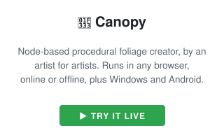
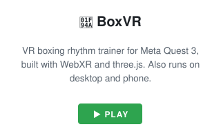
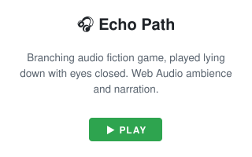
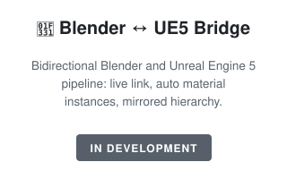
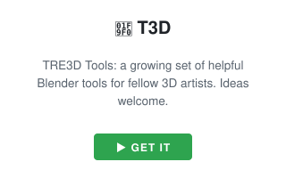
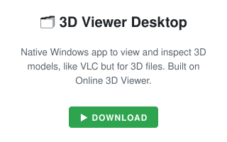
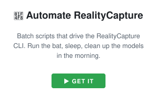
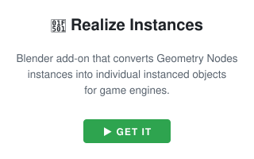

     

---

## 🌿 Senior Biome & Foliage Artist · 10+ Years · AAA

> *"The best environments don't just look real — they feel alive with emotions."*

I build photorealistic game environments for some of the industry's biggest titles. 
I specialise in **foliage systems**, **biome pipelines** and **Blender ↔ Unreal Engine 4/5**, 
and I build the tools that make great art sustainable at scale.

---

## 🚀 Projects

---

## 🎮 Games I contributed to

---

## 📊 GitHub Stats

---

## 📬 Get in Touch

| 🌐 Website | 🎨 Portfolio | ☕ Support | 📧 Email |
|:---:|:---:|:---:|:---:|
| [7bajwa.github.io](https://7bajwa.github.io/) | [ArtStation](https://www.artstation.com/bajwa) | [Patreon](https://www.patreon.com/7bajwa) | [amanpreetbajwa7@gmail.com](mailto:amanpreetbajwa7@gmail.com) |

*Senior Biome & Foliage Artist · BCon Keynote Speaker 2023–2025*

